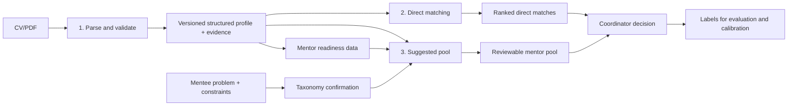

# AI Feature Workflows — One-Page Technical Brief

## Purpose and current decision

TeamTNT's three AI features form one evidence-preserving pipeline: **CV information parsing creates structured profiles; direct matching ranks mentors for a mentee's broader development needs; suggested mentor-pool selection ranks eligible mentors for one specific problem.** The current recommended baseline is local PDF-text extraction, Luna structured parsing with deterministic validation, and local BGE-M3 hybrid retrieval. The tested broad Haiku repair policy should not be enabled by default: it increased parsing cost 5.1× without improving matching metrics and reduced exact quote support.

## 1. Information parsing workflow

**Goal:** convert an uploaded mentor or mentee CV into a safe, reusable, machine-readable profile.

**Flow:** upload PDF → validate file → extract machine-readable text locally → send text and a strict JSON schema to the parser → validate the returned schema → preserve short evidence claims, quotes, and page references → run deterministic quote/page-support checks → record missing fields and warnings → assign a content-based profile version → add the profile to the shared library.

The parser extracts matching-relevant fields such as roles, professional functions, industries, technologies, years of experience, employment and achievement highlights, languages, goals, needs, and preferences. Identity and contact details are not included in matching text. Failed or unusable profiles remain visible instead of silently producing recommendations. Targeted LLM repair should be reserved for hard failures such as empty matching text, invalid schema, missing required experience/sector content, or unsupported evidence—not merely long lists or short employment histories.

## 2. Direct matching workflow

**Goal:** rank mentors against the mentee's overall profile, career direction, and support needs.

**Flow:** load structured mentee and mentor profiles → remove personal data and build deterministic matching text → skip profiles with no usable matching fields → retrieve candidates using 65% semantic similarity and 35% BM25 lexical relevance → calculate field-aware fit → combine field score with semantic and lexical scores → sort deterministically → return top-K mentors with shared fields, score components, profile versions, and explanations.

Field-aware ranking weights are **desired role 25%, skills 25%, goals 20%, industry 10%, experience gap 10%, and preferences 10%**. The final score is **75% field fit + 15% semantic + 10% lexical**. Mentor embeddings are cached by profile version, matching-text version, and provider configuration. Local BGE-M3 is the provisional multilingual embedding choice; benchmark results were promising but still based on small, category-level test sets.

## 3. Suggested mentor-pool selection workflow

**Goal:** identify a small, safe, explainable group of mentors who can help with one concrete mentee problem now.

**Flow:** capture the problem statement, desired outcome, sector, stage, technologies, language, meeting format, organization, experience requirement, and urgency → infer controlled problem domains → coordinator confirms taxonomy → apply hard eligibility rules → discover candidates through taxonomy, BM25, and semantic retrieval → score CV evidence and mentor depth → evidence-aware rerank → select a complementary pool with maximal marginal relevance → sort selected mentors by final score → coordinator approves, removes, reorders, labels, and exports the result.

Hard rules exclude inactive, unavailable, overloaded, conflicted, language/format-incompatible, opted-out, or insufficiently experienced mentors before ranking. Current pool weights are **problem expertise 25%, supporting evidence 30%, mentor depth 25%, startup stage 5%, sector 5%, availability 5%, and preferences 5%**. Evidence must contain problem-specific signals; generic words such as “technology” or “project” are insufficient. Mentor depth separately rewards CV-supported senior experience, preventing a broad student portfolio from outranking a relevant senior professional solely through keyword breadth. Diversity controls pool membership, while displayed rank remains ordered by final score.

## Controls, outputs, and next validation

| Control | System behavior |
|---|---|
| Evidence | Shows the strongest relevant CV claims and flags missing information |
| Safety | Deterministic eligibility rules cannot be overridden by similarity |
| Explainability | Returns taxonomy, lexical, semantic, field, evidence, depth, and confidence signals |
| Human control | Coordinator makes the final assignment decision and can record labels/notes |
| Auditability | Stores profile/model versions, exclusions, weights, run configuration, and review output |

The system should remain a coordinator-assistance tool, not an automatic assignment engine. Production validation should use real coordinator-reviewed pairs and measure Precision@K, Recall@K, NDCG@K, top-1 acceptance, inappropriate-mentor rate, evidence precision, confidence calibration, diversity, repeated exposure, multilingual robustness, latency, and cost. The most valuable next dataset is 100–300 labeled problem–mentor decisions, including junior-versus-senior, incomplete-CV, cross-sector, rare-technology, conflict, and capacity cases.
