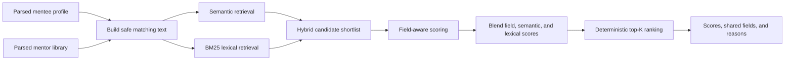

# Direct Mentor Matching — One-Page Workflow Report

## Objective

The direct-matching feature ranks mentors against a mentee's complete structured profile. It answers: **which mentors best fit this mentee's role direction, skills to develop, goals, industry, experience gap, and preferences?** It uses parsed profile data and combines semantic discovery with exact lexical retrieval and explainable field-level scoring.

## Workflow

1. **Load profiles:** the matcher receives one parsed mentee record and a versioned mentor library. Mentors without usable matching fields are skipped and reported.
2. **Build matching text:** deterministic adapters select only relevant fields, normalize and sort values, remove identity/contact data, and produce versioned text for embeddings and BM25.
3. **Semantic retrieval:** mentee and mentor texts are embedded. Local BGE-M3 is the recommended baseline because it supports multilingual retrieval. Mentor embeddings are cached using mentor profile version, matching-text version, and provider configuration.
4. **Lexical retrieval:** BM25 independently rewards exact terms such as named technologies, roles, sectors, and specialist skills.
5. **Hybrid discovery:** the candidate shortlist uses **65% normalized semantic score and 35% lexical score**. This reduces dependence on either vocabulary matching or embedding similarity alone.
6. **Field-aware scoring:** shortlisted mentors are compared against the mentee on desired role, skills, goals, industry, experience gap, and language/preferences.
7. **Final scoring:** candidates are sorted by a blended final score, with mentor ID used as the deterministic tie-breaker.
8. **Explainable output:** every recommendation includes rank, component scores, semantic and lexical scores, exact shared fields, profile versions, matching text, and concise reasons.

## Current scoring model

| Field component | Weight | Interpretation |
|---|---:|---|
| Desired role | 25% | Mentor experience aligns with the mentee's target/current role |
| Skills | 25% | Mentor offers technologies or expertise the mentee wants to develop |
| Goals | 20% | Mentor expertise supports goals, needs, bottlenecks, or desired support |
| Industry | 10% | Mentor industry overlaps the mentee's sector preference |
| Experience gap | 10% | Mentor has enough additional experience to guide the mentee |
| Preferences | 10% | Language or other available preference information aligns |

The field score is the weighted sum above. The final score is **75% field score + 15% semantic score + 10% BM25 score**. If experience years are missing, the component uses a neutral value rather than assuming zero. Exact shared fields are reported separately; semantic similarity is never presented as an exact field match.

## Approaches considered and findings

| Approach | Strength | Finding or limitation |
|---|---|---|
| Rules/exact fields only | Highly explainable and deterministic | Misses paraphrases, related skills, and cross-language similarity; sparse profiles receive very low recall |
| BM25 lexical search only | Strong for exact roles, technologies, and rare terms | Sensitive to wording and repetition; cannot reliably recognize semantically related language |
| Embedding cosine only | Captures paraphrases and broader meaning | Can reward generally similar CVs without confirming the required role, skill, industry, or experience gap |
| Hybrid semantic + BM25 discovery | Combines conceptual and exact-term recall | Implemented shortlist uses 65% semantic and 35% lexical score; still needs field-aware ranking after retrieval |
| Field-aware weighted ranking | Makes role, skills, goals, industry, experience, and preferences separately visible | More explainable and controllable than one cosine score, but weights require calibration with real decisions |
| Cross-encoder pair reranking | Can evaluate a mentee–mentor pair more deeply than independent embeddings | Higher latency and operational complexity; not the current direct-matching default and needs labeled evaluation |
| Learning-to-rank | Can learn weights and interactions from coordinator choices | Requires a sufficiently large, representative label set and careful bias monitoring |

The embedding comparison tested BGE-M3, OpenAI `text-embedding-3-small`, and Qwen3. In the initial five-query pilot, all three retrieved every expected mentor in the top three and ranked the expected mentor first; this was too small to establish a definitive winner. BGE-M3 was provisionally favored for multilingual suitability and tied low price. In the later ten-CV comparison, BGE-M3 and Qwen3 produced identical results within each parser pool, while changing the parser changed matching quality. This indicates that **profile extraction quality can matter more than small embedding-model differences**.

The current code therefore uses a two-stage approach: hybrid retrieval first, then field-aware scoring. It also keeps exact shared fields separate from semantic similarity so the UI does not present an inferred relationship as a verified match. Cosine similarity is a retrieval signal, not a compatibility percentage.
