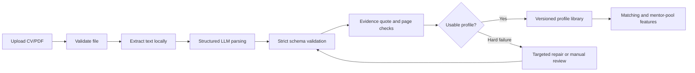

# Information Parsing — One-Page Workflow Report

## Objective

The information-parsing feature converts an uploaded mentor or mentee CV into a validated, versioned JSON profile that can be reused by direct matching and suggested mentor-pool selection. Its job is not merely to summarize the document: it must extract matching-relevant facts while preserving enough source evidence to audit important claims.

## Workflow

1. **Upload and validation:** the application accepts a CV/PDF, verifies that it is a supported readable file, and rejects invalid input before any model call.
2. **Local text extraction:** machine-readable text is extracted locally. This reduces file-processing cost and avoids sending the original PDF when text extraction is sufficient.
3. **Structured parsing:** the extracted text and role-specific instructions are sent to the configured parser. The current recommendation is `openai/gpt-5.6-luna` for local-text parsing.
4. **Strict validation:** the response must conform to the mentor or mentee JSON schema. Invalid types, missing required structure, empty responses, and malformed JSON produce an explicit failure instead of a partial profile.
5. **Evidence preservation:** employment and achievement items retain a concise claim, short verbatim quote, page number, and information type when supported by the source.
6. **Deterministic audit:** the system checks whether evidence quotes occur in the extracted document and, when a page is supplied, on the cited page. This measures source support, not full semantic correctness.
7. **Versioning and storage:** usable output receives a profile version derived from parser output. The structured profile is added to the shared library used by both ranking features.
8. **Escalation:** repair is reserved for hard failures such as invalid schema, unusable matching text, missing required sector/experience content, or unsupported evidence. Unsuccessful repair falls back safely or enters manual review.

## Main profile fields

| Mentor profile | Mentee profile |
|---|---|
| Professional functions and summary | Current and desired role |
| Industries and technologies | Sector, technologies, and projects |
| Years of experience | Experience level and years |
| Employment and achievement evidence | Needs, bottlenecks, and goals |
| Languages and mentoring areas | Skills to develop and support needs |
| Missing fields and warnings | Preferences and missing information |

Personal contact information is not included in downstream matching text. Missing or uncertain fields remain visible so ranking features do not treat absence as verified negative evidence.

## Approaches considered and findings

| Approach | What was tested or discussed | Finding |
|---|---|---|
| Local text + structured LLM | Extract PDF text locally, then request schema-constrained JSON | Most practical tested path: lower file-processing cost, inspectable source text, and deterministic quote checks |
| Direct-PDF parsing | Send the original PDF to a multimodal/file-capable model | Not benchmarked fairly because OpenRouter rejected file inputs without at least $0.50 purchased credit; quality and cost remain unknown |
| Luna parser | Low-cost OpenAI model using local text | Only parser in the five-CV pilot with 5/5 schema-valid profiles; 95.4% judged accuracy and 91.4% quote support |
| Gemini Flash Lite | Lower-cost local-text parser | Faster and cheaper, but only 3/5 profiles were usable; success-adjusted accuracy fell to 50.0% |
| Free Gemma | Free local-text parser | Only 2/5 profiles were usable, latency was high, and quote support was much weaker |
| Claude Haiku | Alternative structured parser | Completed 10/10 in the later comparison and improved downstream matching for that small cohort, but cost about 7.6× Luna and had lower quote support |
| Claude Sonnet | Higher-capability parser | One smoke profile succeeded, but 9/10 comparable runs were credit-blocked; there is not enough evidence for a fair conclusion |
| Luna + targeted Haiku repair | Parse with Luna, detect weak profiles, and repair selected fields with Haiku | Broad repair triggers flagged 9/10 CVs, raised cost 5.1×, did not improve matching metrics, and reduced exact quote support from 97.2% to 92.4% |
| Deterministic normalization | Clean lists, types, duplicates, and evidence without another LLM | Useful for predictable schema cleanup and avoids adding unsupported content; it cannot recover genuinely missing source information |

The reports therefore show a tradeoff between **cost, schema reliability, evidence fidelity, and downstream retrieval quality**. No parser was best on every dimension. They also show that a parser should be judged by whether its fields improve later matching—not only by whether its summary sounds complete.
