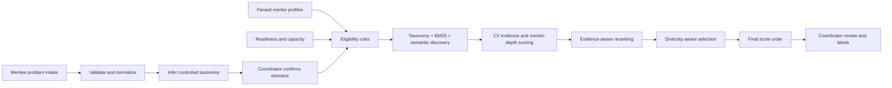

# Suggested Mentor Pool Selection — One-Page Workflow Report

## Objective

The suggested mentor-pool feature identifies a small, safe, explainable group of mentors for one concrete mentee problem. Unlike direct matching, it considers the immediate problem, operational readiness, hard constraints, CV evidence, mentor-level experience, and pool diversity. It recommends candidates for coordinator review; it does not automatically assign mentors.

## Workflow

1. **Problem intake:** capture the problem statement, desired outcome, domains, sector, startup stage, technologies, language, meeting format, organization, minimum experience, and urgency.
2. **Interpretation:** preserve the original statement, normalize structured fields, infer controlled capability domains, and let the coordinator correct the taxonomy before retrieval.
3. **Eligibility:** exclude inactive, unavailable, overloaded, conflicted, language/format-incompatible, opted-out, or insufficiently experienced mentors. Rule failures produce auditable reason codes and cannot be overridden by similarity.
4. **Hybrid discovery:** combine controlled taxonomy overlap, BM25 exact-term retrieval, and semantic embeddings. Local BGE-M3 is the intended multilingual semantic provider; deterministic embeddings support repeatable offline tests.
5. **Problem expertise:** combine taxonomy and semantic alignment to measure whether the CV addresses the confirmed problem domains.
6. **Evidence scoring:** search employment and achievement claims for problem-specific evidence. Generic words such as “technology,” “application,” or “project” are insufficient. Evidence quality considers relevance, depth, explicit support, responsibility, outcomes, and recency.
7. **Mentor depth:** score CV-supported professional experience separately from topic breadth. Explicit years receive the strongest evidence; student/intern indicators remain low, while unconfirmed senior roles receive conservative provisional credit.
8. **Reranking and diversity:** an evidence-aware reranker emphasizes CV evidence and mentor depth. Maximal marginal relevance selects a complementary pool and penalizes duplicate expertise or repeated exposure. Selected mentors are then displayed in descending final-score order.
9. **Review:** the coordinator inspects evidence, approves or removes candidates, manually reorders the pool, assigns strong/possible/weak/inappropriate labels, adds notes, and exports the run and review record.

## Current scoring model

| Pool component | Weight |
|---|---:|
| Problem expertise | 25% |
| Supporting CV evidence | 30% |
| Mentor depth | 25% |
| Startup-stage experience | 5% |
| Sector experience | 5% |
| Availability | 5% |
| Confirmed preferences | 5% |

The default reranker uses **15% taxonomy, 15% BM25, 15% semantic similarity, 30% evidence quality, and 25% mentor depth**. Its output is blended with the field-aware score. Confidence separately considers retrieval-signal agreement, evidence quality, and profile completeness; low confidence signals review need rather than automatic exclusion.

## Approaches considered and findings

| Approach | Strength | Finding or limitation |
|---|---|---|
| Eligibility rules only | Safe, predictable, and auditable | Determines who may be considered but cannot decide who is most relevant |
| Taxonomy-only ranking | Maps problems to controlled mentor capabilities | Broad categories can overrank a CV with shallow keyword coverage |
| BM25-only ranking | Finds exact technologies and specialist phrases | Can overvalue repeated terms and miss paraphrased expertise |
| Embedding-only ranking | Finds semantic and multilingual similarity | May select generally similar profiles with weak CV evidence or insufficient mentor depth |
| Hybrid taxonomy + BM25 + embeddings | Improves candidate discovery across controlled, exact, and semantic signals | Retrieval alone is insufficient; candidates still require evidence and suitability scoring |
| Field-aware weighted scoring | Separates expertise, evidence, experience, stage, sector, readiness, and preferences | Transparent but dependent on manually chosen weights until enough labels exist |
| Evidence-aware reranker | Rewards explicit, problem-specific CV claims and mentor depth | Network-free and explainable; more limited than a trained pairwise cross-encoder |
| Cross-encoder reranker | Can read the problem and candidate evidence jointly | Optional architecture; slower and must fall back safely if unavailable |
| Top-score selection only | Returns the individually highest scores | Can produce a repetitive pool with nearly identical mentor backgrounds |
| MMR diversity selection | Balances relevance with complementary expertise and exposure | May choose a slightly lower-scoring mentor for pool membership; final displayed ranks are therefore re-sorted by score |
| Coordinator review | Handles context absent from CVs and creates labels | Necessary for safety, but reviewer inconsistency and historical bias must remain visible |

The combined approach was chosen because the stages solve different problems: **rules establish permission, hybrid retrieval finds candidates, CV evidence establishes relevance, mentor depth establishes suitability, MMR shapes the group, and coordinator review makes the final decision**. A single model score cannot reliably replace all six functions.

## Corrected ranking finding

The AI-health MVP example exposed an earlier weakness: a student/intern profile ranked above an eight-year data scientist because broad taxonomy and generic CV overlap received too much credit. The corrected workflow rejects generic database evidence as proof of AI suitability, selects genuine TensorFlow/ML or OpenAI/transformer evidence, and includes professional mentor depth. This makes senior, directly relevant CV evidence capable of overriding shallow keyword breadth while keeping legitimate junior project experience visible.
