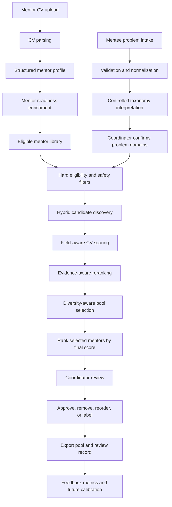
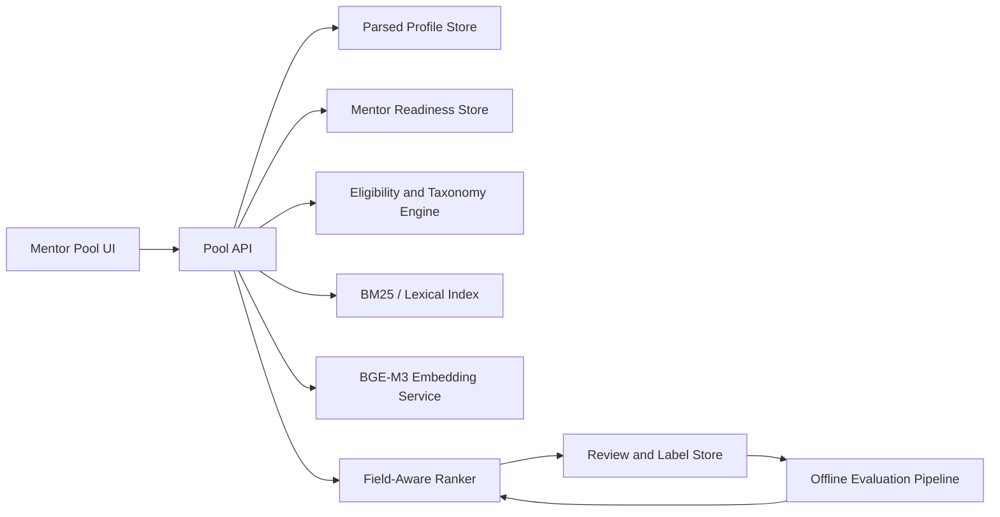

# Suggested Mentor Pool Selection — Workflow and Technical Report

## Executive summary

The suggested mentor pool is a decision-support workflow that converts a mentee's problem into a small, reviewable list of eligible mentors. It does not rely on one similarity score. It combines:

1. deterministic problem interpretation and controlled taxonomy;
2. hard eligibility and safety rules;
3. lexical and semantic candidate discovery;
4. field-aware scoring against mentor CVs;
5. problem-specific evidence validation;
6. mentor-level experience depth;
7. evidence-aware reranking and diversity selection; and
8. coordinator approval, rejection, relabeling, and export.

The current design intentionally keeps a human coordinator in control. The system recommends and explains; it does not automatically assign a mentor.

## Relationship to parsing and direct matching

The three AI features share parsed profiles but answer different questions:

| Feature | Main question | Primary input | Output |
|---|---|---|---|
| CV parsing | What does this CV contain? | CV/PDF | Structured mentee or mentor profile with evidence |
| Direct matching | How compatible are this mentee and this mentor? | One mentee profile and mentor profiles | Ranked mentor-to-mentee matches |
| Suggested mentor pool | Who can credibly help with this specific problem now? | Problem statement, constraints, mentor profiles, readiness data | Small coordinator-reviewed mentor pool |

The pool feature should consume the parser's structured CV output rather than reparsing CVs. It can reuse the matching feature's embedding provider and cache, but it adds problem taxonomy, eligibility, evidence scoring, mentor-depth scoring, diversity, and review state.

## End-to-end workflow

## Stage 1 — Mentor CV parsing

Each mentor CV is converted into a structured profile. The pool algorithm uses fields such as:

- full name and stable mentor ID;
- professional summary;
- professional functions;
- industries and sectors;
- technologies;
- total years of experience, when explicitly supported;
- employment highlights;
- achievement highlights;
- startup-stage experience;
- languages; and
- missing fields and parser warnings.

Employment and achievement claims retain evidence metadata where available, including the information type and source page. This lets the pool explain why a mentor was recommended and lowers the risk of ranking candidates using unsupported generated summaries.

The current parsing recommendation from the earlier pilot remains local text extraction with Luna structured parsing, followed by deterministic validation. Local BGE-M3 remains the preferred embedding baseline, subject to broader evaluation.

## Stage 2 — Mentor readiness enrichment

CVs describe professional history but usually do not contain operational mentoring constraints. A readiness record supplements each parsed mentor profile with:

- active/inactive status;
- available capacity and current load;
- maximum load;
- supported languages;
- meeting formats;
- preferred problem domains;
- excluded problem domains;
- conflict organizations; and
- recent recommendation count.

CV-derived expertise and coordinator-controlled readiness must remain separate. A model may infer likely expertise from a CV, but it should not invent availability, conflicts, consent, or capacity.

## Stage 3 — Mentee problem intake

The pool starts with a concrete problem rather than a generic request for a mentor. The current intake accepts:

- problem statement;
- desired outcome;
- problem domains;
- sectors;
- startup stage;
- relevant technologies;
- required languages;
- meeting format;
- organization;
- minimum mentor experience; and
- urgency.

The problem statement is preserved verbatim as the principal retrieval query. Lists and categorical values are cleaned and normalized. Invalid or too-short problem statements are rejected before retrieval.

## Stage 4 — Controlled taxonomy interpretation

The system maps the problem to a controlled capability taxonomy. Current examples include:

- customer discovery;
- product-market fit;
- go-to-market;
- enterprise sales;
- pricing and negotiation;
- fundraising;
- financial management;
- operations and supply chain;
- hiring and leadership;
- regulatory compliance;
- technology architecture;
- AI product strategy; and
- cybersecurity.

Aliases support natural-language detection. For example, AI product strategy can be detected from terms such as artificial intelligence, machine learning, TensorFlow, OpenAI, transformers, LLMs, NLP, or computer vision.

The coordinator reviews the detected domains before generating the pool. This confirmation is important because taxonomy correctness influences every later score.

## Stage 5 — Eligibility and safety filtering

Eligibility is evaluated before ranking. A mentor is excluded when any hard rule fails:

| Rule | Example exclusion |
|---|---|
| Active status | Mentor has paused participation |
| Capacity | No available mentoring slots |
| Maximum load | Current load has reached the configured maximum |
| Conflict of interest | Mentor conflicts with the mentee's organization |
| Language | Required language is unsupported or unconfirmed |
| Meeting format | Required format is unsupported or unconfirmed |
| Excluded domain | Mentor has opted out of the problem domain |
| Minimum experience | CV-supported experience is below the mentee's requirement |

Excluded mentors remain auditable with explicit reason codes, but they do not enter the ranking stage. This prevents a high semantic score from overriding consent, safety, or availability.

## Stage 6 — Hybrid candidate discovery

Every eligible mentor receives three initial retrieval signals.

### Taxonomy retrieval

The system infers mentor capability domains from professional functions, expertise, mentoring areas, employment evidence, and confirmed preferences. It calculates overlap with the confirmed problem domains.

### Lexical retrieval

BM25 searches the mentor corpus for exact and rare terms from the problem statement, desired outcomes, taxonomy domains, sector, startup stage, and technologies. Lexical search is useful for named technologies, certifications, and domain terminology.

### Semantic retrieval

An embedding matcher compares the structured problem profile with structured mentor profiles. Local BGE-M3 is the intended default for multilingual semantic retrieval. The prototype also supports deterministic offline embeddings for repeatable tests and optional configured providers.

Hybrid retrieval reduces dependence on a single failure-prone signal:

- taxonomy provides controlled meaning;
- BM25 captures exact terminology; and
- embeddings capture paraphrases and related concepts.

## Stage 7 — Field-aware CV scoring

Discovery finds candidates; field-aware scoring estimates suitability. The current default component weights are:

| Component | Weight | Purpose |
|---|---:|---|
| Problem expertise | 25% | Taxonomy and semantic alignment with the problem |
| Supporting evidence | 30% | Strength and relevance of explicit CV claims |
| Mentor depth | 25% | CV-supported professional experience appropriate for mentoring |
| Startup stage | 5% | Experience with the mentee's current stage |
| Sector | 5% | Direct sector overlap |
| Availability | 5% | Remaining operational capacity |
| Preferences | 5% | Confirmed interest in the problem domain |

The weights are normalized, so custom configurations still produce a comparable final score.

### Problem-expertise score

Problem expertise combines controlled taxonomy overlap with semantic similarity. Taxonomy prevents a semantically similar but functionally unrelated CV from receiving full credit.

### Supporting-evidence score

Evidence is collected from employment highlights, achievement highlights, and structured professional experience. Claims are ranked using problem-specific signal terms rather than generic overlap.

For an AI integration problem, evidence mentioning TensorFlow, machine learning, OpenAI, transformers, computer vision, or related architecture concepts is relevant. A claim that only contains generic words such as “technology,” “project,” or “application” is not sufficient.

Evidence quality considers:

- query relevance;
- number of relevant claims;
- whether the claim is explicit;
- responsibility indicators such as built, led, designed, or managed;
- outcome indicators such as improved, reduced, launched, or delivered; and
- recency when dates are available.

### Mentor-depth score

Mentor depth prevents a broad student portfolio from automatically outranking a senior professional CV. Explicit years of experience are scaled toward full credit at eight years. When years are unavailable, the system uses conservative role evidence:

- student, intern, junior, or entry-level profiles receive low depth;
- senior, lead, director, head, founder, or manager indicators receive higher provisional depth; and
- unconfirmed professional depth receives a neutral-low score and remains visible as uncertainty.

This component does not claim that experience alone guarantees good mentoring. It ensures that mentor-level professional depth is considered separately from keyword breadth.

## Stage 8 — Evidence-aware reranking

The default network-free reranker recalculates pair relevance from:

- taxonomy: 15%;
- BM25 lexical retrieval: 15%;
- semantic retrieval: 15%;
- evidence quality: 30%; and
- mentor depth: 25%.

The reranker score is blended with the field-aware score rather than replacing it. An optional HTTP cross-encoder can be configured later, but it should be evaluated against coordinator labels before becoming the default.

If an external reranker fails, the system falls back to the local evidence-aware reranker and records the fallback reason.

## Stage 9 — Diversity-aware pool selection

Returning five almost identical mentors is less useful than returning a strong but complementary pool. Maximal marginal relevance selects pool membership using:

- candidate final relevance;
- similarity to mentors already selected;
- recent recommendation exposure; and
- a relevance weight that currently dominates the diversity penalty.

Diversity affects which mentors enter the limited pool. After selection, displayed ranks are sorted by final score so the rank column remains understandable and score order is monotonic.

## Stage 10 — Confidence and explanations

Each candidate includes:

- final score;
- component scores;
- taxonomy, lexical, semantic, and reranker scores;
- selected CV evidence;
- eligibility status;
- confidence level;
- confidence caveats; and
- important missing fields.

Confidence combines retrieval-signal agreement, evidence quality, and profile completeness. Low confidence does not automatically exclude a candidate. It tells the coordinator that the recommendation requires closer review.

The explanation should cite the strongest relevant CV claim, not merely repeat taxonomy labels. If there is no defensible problem-specific evidence, the UI states that coordinator evidence review is required.

## Stage 11 — Coordinator review and export

The coordinator can:

- inspect candidate details;
- approve or unapprove a mentor;
- remove a suggestion;
- manually reorder the pool;
- label the fit as strong, possible, weak, or inappropriate;
- add notes; and
- export the pool and review JSON.

Manual changes are preserved separately from algorithmic scores. This is important for auditability: the system can show both its original ranking and the coordinator's final decision.

## Stage 12 — Feedback and future learning

Review labels create the first useful ground truth for improving the algorithm. The system can aggregate:

- approval rate;
- label distribution;
- approval rate by score band; and
- accepted and rejected candidates by problem domain.

The next calibration stage should compare predicted rank with coordinator judgments. When enough labeled cases exist, weights or a learning-to-rank model can be trained offline. The raw CV, protected attributes, and coordinator notes should not be sent to an external training service without an explicit data-governance decision.

## Worked ranking example

For the problem “integrate AI into a calorie-tracking health app MVP,” the confirmed domains are technology architecture and AI product strategy.

An earlier version ranked a student/intern profile above an eight-year data scientist because broad taxonomy overlap and many generic claims received too much credit. The corrected workflow:

1. rejects generic database-internship text as AI evidence;
2. selects TensorFlow and machine-learning evidence for the data scientist;
3. selects genuine transformer or OpenAI evidence for the student profile;
4. scores professional mentor depth separately; and
5. ranks the experienced data scientist first while keeping the student's legitimate project relevance visible.

This example demonstrates why relevance and mentor suitability must be distinct components.

## Data contracts

### Main input objects

- parsed mentor profiles;
- mentor readiness enrichment keyed by mentor ID;
- validated mentee problem profile;
- embedding-provider configuration;
- optional custom weights;
- pool size; and
- optional reranker configuration.

### Main output objects

- normalized problem profile;
- eligible and excluded counts;
- exclusions with reason codes;
- full ranked candidates;
- selected mentor pool;
- component and retrieval scores;
- evidence assessments;
- confidence and caveats;
- diversity metadata;
- provider and reranker configuration; and
- stable run ID for review and export.

## Recommended production architecture

Recommended implementation boundaries:

- keep CV parsing asynchronous and versioned;
- cache mentor embeddings by profile version;
- rebuild lexical indexes when profiles change;
- store readiness separately from CV facts;
- make eligibility rules deterministic and testable;
- version taxonomy, weights, and reranker configuration with every run;
- retain selected evidence and score breakdowns for audit; and
- keep coordinator decisions append-only where practical.

## Evaluation plan

The pool should not be declared production-ready using only synthetic or Kaggle-category labels. The next evaluation should use coordinator-reviewed problem–mentor pairs.

Recommended offline metrics:

- Precision@K and Recall@K;
- NDCG@K for ordered relevance;
- top-1 coordinator acceptance rate;
- inappropriate-mentor rate;
- eligible-mentor recall;
- evidence precision: percentage of displayed claims judged truly relevant;
- calibration by confidence band;
- pool diversity and repeated-exposure rate;
- ranking stability after small wording changes; and
- latency and cost per generated pool.

Recommended test groups include multilingual problems, incomplete CVs, junior-versus-senior candidates, cross-sector expertise, missing years of experience, rare technologies, strict availability constraints, and conflict-of-interest cases.

## Risks and limitations

- A CV is evidence of experience, not evidence of mentoring skill, communication quality, or availability.
- Parsed years of experience may be missing or inaccurate.
- Taxonomy aliases can over-map broad terms if not reviewed.
- Semantic similarity can reward fluent but weakly supported profile text.
- BM25 can overvalue repeated keywords.
- Sector and startup-stage fields are often missing from public CVs.
- Diversity selection can exclude a near-duplicate candidate who has a slightly higher relevance score.
- Confidence is a heuristic until calibrated against real coordinator labels.
- Historical coordinator decisions can encode human bias.
- Protected characteristics must not become ranking features.

## Recommended next steps

1. Collect coordinator labels for at least 100–300 real problem–mentor candidate pairs.
2. Add verified mentoring history, mentoring topics, and prior outcome signals as separate fields.
3. Evaluate local BGE-M3 against the deterministic provider on multilingual problems.
4. Build a labeled evidence-relevance test set to tune the evidence gate.
5. Calibrate component weights by NDCG and inappropriate-mentor rate, not only acceptance rate.
6. Evaluate a local cross-encoder against the current evidence-aware reranker.
7. Add fairness and repeated-exposure monitoring before automated assignment.
8. Keep coordinator approval mandatory until ranking quality and confidence calibration are demonstrated on real program data.

## Final recommendation

Use the current workflow as a transparent coordinator-assistance tool:

**parsed mentor profiles → readiness rules → confirmed problem taxonomy → hybrid discovery → CV evidence and mentor-depth scoring → reranking → diversity selection → coordinator review → feedback collection.**

The strongest design property is not a particular model. It is the separation of deterministic eligibility, explainable CV evidence, semantic discovery, and human decision-making. That separation makes failures visible and gives the team useful labels for safely improving the ranking algorithm.
